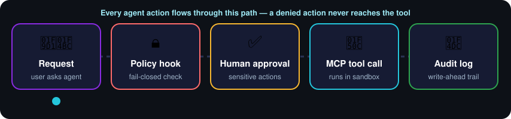
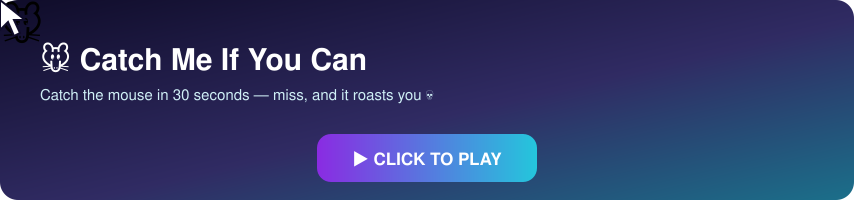

<!-- ═══════════════════════════ HEADER ═══════════════════════════ -->

  

  

  
  
  
  

  
  
  
  

<!-- ═══════════════════════════ ABOUT ═══════════════════════════ -->

<table>
<tr>
<td width="60%" valign="top">

I design and ship **multi-tenant AI platforms end to end**: agent orchestration, governance and guardrails, Python and TypeScript backends, React front ends, and AWS infrastructure as code.

> 🛡️ **My rule is simple: a model never holds authority on its own.**
> Sensitive actions wait for a human, customer data stays protected, and every action can be traced.

🎓 IBM-certified Full Stack Developer
🌍 Somali · English · Arabic
⏰ 3+ hours daily overlap with U.S. and European time zones

</td>
<td width="40%" valign="top">

**🎯 Specialties**

- 🤖 AI agents & multi-agent orchestration
- ✅ Governed, auditable AI with human approval
- 🏢 Multi-tenant SaaS architecture
- ☁️ AWS infrastructure as code
- 📊 Data pipelines, connectors & reporting

</td>
</tr>
</table>

  
  
  
  

<!-- ═══════════════════════════ PIPELINE ═══════════════════════════ -->

  

<!-- ═══════════════════════════ PROJECTS ═══════════════════════════ -->

<table>
<tr>
<td width="50%" valign="top">

### 🛡️ NOVA
**Governance Platform for AI Agents** · `2026`

*Run AI agents in a business under policy, with human approval and a verifiable audit trail.*

       

<b>👉 Click to see how it works</b>

 

- 🧩 Multi-tenant control plane over the open-source Hermes Agent runtime, without forking it
- 🔒 Permissions compiled into a **fail-closed pre-tool-call hook**: denied actions are blocked inside the agent process, not just hidden in the UI
- 📜 **Write-ahead audit log**: intent before every change, committed or failed after, with human actor, tenant and correlation ID
- 🏢 Tenant isolation in SQL with fair scheduling and per-tenant concurrency limits
- 💬 Human approval gates, governed scheduled automations, and agent routing across Telegram, Slack, Discord, WhatsApp and Signal
- 🎛️ White-label Control Center (React 19, Tailwind 4) with RBAC, CSRF protection and strict CSP
- ☁️ Terraform for AWS (EC2, EBS, KMS, IAM, ECR, CloudWatch, SSM): no inbound ports, IMDSv2, per-integration IAM roles
- 🧪 **900+ tests**, including tests that fail the build if architecture boundaries are crossed

</td>
<td width="50%" valign="top">

### 📊 DataEngine
**AI Data-Operations Copilot** · `2026`

*For accounting firms and retailers: messy spreadsheets in, approved fixes and client-ready reports out.*

       

<b>👉 Click to see how it works</b>

 

- 🧠 AI profiles client workbooks and proposes materiality-ranked fixes; **an accountant approves each change** before it becomes a new immutable version
- ⚙️ Postgres job queue with leases: the agent host needs no inbound ports, and a restart delays work instead of losing it
- 🧮 Deterministic maths in Polars and DuckDB; the LLM only makes judgment calls, through a **redaction layer** that keeps raw customer rows away from the model
- 🔐 Multi-tenant Supabase with Row-Level Security, membership-checking functions, tenant-scoped storage and Vault-held credentials
- 🔌 QuickBooks Online, Odoo and spreadsheet connectors; profit reports in **English and Somali** (PDF, Word, Excel, Markdown)
- 🚢 CI/CD with GitHub Actions over a private Tailscale network; **600+ Python tests** plus an end-to-end suite

</td>
</tr>
</table>

<table>
<tr>
<td width="25%" align="center" valign="top">

### 🇸🇴
**Somali AI Companion**

First AI companion for Somali speakers: bilingual Somali–English chat with a culturally relevant personality.

`OpenAI` `React` `Convex` `Clerk`

</td>
<td width="25%" align="center" valign="top">

### 💳
**Agentic Bill Payment Agent**

Handles bill payments and customer queries end to end, with error recovery and human escalation.

`Python` `OpenAI` `Agentic`

</td>
<td width="25%" align="center" valign="top">

### 🏥
**Hospital Management System**

Patient records, appointments, billing and staff management for Somali healthcare providers.

`React` `Node.js` `PostgreSQL`

</td>
<td width="25%" align="center" valign="top">

### 📖
**Quran School Platform**

Teacher and student dashboards with attendance, scheduling and progress tracking.

`React` `Node.js` `Django`

</td>
</tr>
</table>

<!-- ═══════════════════════════ TECH STACK ═══════════════════════════ -->

  <a href="https://skillicons.dev">
    
     
    
  </a>

<b>🔍 Click to expand the full stack</b>

 

<table align="center">
<tr>
<td valign="top" width="25%">

**🤖 AI & Agents**

</td>
<td valign="top" width="25%">

**☁️ Cloud & DevOps**

</td>
<td valign="top" width="25%">

**🗄️ Backend & Data**

</td>
<td valign="top" width="25%">

**🔐 Security**

</td>
</tr>
</table>

<!-- ═══════════════════════════ HOW I BUILD ═══════════════════════════ -->

<table>
<tr>
<td align="center" width="25%">🧑‍⚖️ <b>AI suggests, humans decide</b> on anything touching money, customers or records</td>
<td align="center" width="25%">🔍 <b>Every action is traceable</b> who asked, what ran, what changed</td>
<td align="center" width="25%">🤝 <b>Honest status</b> the product never claims a control it doesn't enforce</td>
<td align="center" width="25%">🧪 <b>Tested, then shipped</b> in small increments</td>
</tr>
</table>

<!-- ═══════════════════════════ EXPERIENCE ═══════════════════════════ -->

<table>
<tr>
<td width="55%" valign="top">

#### 🧑‍💻 Independent Software & AI Engineer
 

- Design and build AI agent platforms, SaaS products and automation systems end to end
- Created **NOVA** and **DataEngine**, plus apps and AI assistants for healthcare, education and customer service
- Production discipline: small commits, automated tests, Docker, CI/CD and infrastructure as code

#### 🎧 Customer Service & Sales Representative
 

- Four years of front-line support and sales across phone, chat and in person
- The reason my customer-facing agents have clear human handover, approval steps and a tone real customers accept

</td>
<td width="45%" valign="top">

#### 🎓 Education

🏅 **IBM Full Stack Software Developer**
Professional Certificate · Coursera · 2025 15 courses: Python, Django, React, Node.js, microservices, Docker, Kubernetes, OpenShift, CI/CD

🤖 **AI Engineering** — continuing self-study
LLM applications, agentic systems, RAG and AI safety patterns

⚖️ **Bachelor of Islamic Law**
Beder International University, Hargeisa

#### 🌍 Languages
  

</td>
</tr>
</table>

<!-- ═══════════════════════════ PLAY ═══════════════════════════ -->

### 🐭 Catch Me If You Can

  

Opens instantly in your browser — works with a mouse or by tapping on your phone.

### ❌⭕ Tic-Tac-Toe vs. my bot

Click a square → GitHub opens an issue → press <b>Create</b> → a GitHub Action plays my move and updates this board in about a minute.

<!-- TTT:START -->

<b>Your turn!</b> You are ❌. Click any ⬜ square to play — I'm ⭕ and I reply automatically.

<table align="center"><tr><td align="center" width="80" height="80"><a href="https://github.com/yahyeameer/yahyeameer/issues/new?body=Just+press+%22Create%22+%E2%80%94+the+board+updates+in+about+a+minute.&title=ttt%7Cmove%7C0"><h1>⬜</h1></a></td><td align="center" width="80" height="80"><a href="https://github.com/yahyeameer/yahyeameer/issues/new?body=Just+press+%22Create%22+%E2%80%94+the+board+updates+in+about+a+minute.&title=ttt%7Cmove%7C1"><h1>⬜</h1></a></td><td align="center" width="80" height="80"><a href="https://github.com/yahyeameer/yahyeameer/issues/new?body=Just+press+%22Create%22+%E2%80%94+the+board+updates+in+about+a+minute.&title=ttt%7Cmove%7C2"><h1>⬜</h1></a></td></tr><tr><td align="center" width="80" height="80"><a href="https://github.com/yahyeameer/yahyeameer/issues/new?body=Just+press+%22Create%22+%E2%80%94+the+board+updates+in+about+a+minute.&title=ttt%7Cmove%7C3"><h1>⬜</h1></a></td><td align="center" width="80" height="80"><a href="https://github.com/yahyeameer/yahyeameer/issues/new?body=Just+press+%22Create%22+%E2%80%94+the+board+updates+in+about+a+minute.&title=ttt%7Cmove%7C4"><h1>⬜</h1></a></td><td align="center" width="80" height="80"><a href="https://github.com/yahyeameer/yahyeameer/issues/new?body=Just+press+%22Create%22+%E2%80%94+the+board+updates+in+about+a+minute.&title=ttt%7Cmove%7C5"><h1>⬜</h1></a></td></tr><tr><td align="center" width="80" height="80"><a href="https://github.com/yahyeameer/yahyeameer/issues/new?body=Just+press+%22Create%22+%E2%80%94+the+board+updates+in+about+a+minute.&title=ttt%7Cmove%7C6"><h1>⬜</h1></a></td><td align="center" width="80" height="80"><a href="https://github.com/yahyeameer/yahyeameer/issues/new?body=Just+press+%22Create%22+%E2%80%94+the+board+updates+in+about+a+minute.&title=ttt%7Cmove%7C7"><h1>⬜</h1></a></td><td align="center" width="80" height="80"><a href="https://github.com/yahyeameer/yahyeameer/issues/new?body=Just+press+%22Create%22+%E2%80%94+the+board+updates+in+about+a+minute.&title=ttt%7Cmove%7C8"><h1>⬜</h1></a></td></tr></table>

🏆 Humans won: <b>0</b> · 🤖 Bot won: <b>0</b> · 🤝 Draws: <b>0</b> Recent players: <a href="https://github.com/yahyeameer">@yahyeameer</a>

<!-- TTT:END -->

### 🧠 Quick quiz — click to reveal

<b>Q1. In NOVA, what happens when an agent tries an action its policy doesn't allow?</b>

 
🔒 The fail-closed pre-tool-call hook blocks it <b>inside the agent process</b>, before the tool ever runs, and the attempt is written to the audit log.

<b>Q2. Why does DataEngine do the maths in Polars and DuckDB instead of the LLM?</b>

 
🧮 Numbers must be exact and repeatable. The LLM only makes judgment calls, and a redaction layer keeps raw customer rows away from it.

<b>Q3. How many automated tests guard my two platforms?</b>

 
🧪 <b>1,500+</b> — 900+ in NOVA and 600+ in DataEngine, plus an end-to-end suite.

<b>Q4. "Iska warran" — what language is that, and what does it mean?</b>

 
🇸🇴 Somali, for <i>"How are you?"</i> I build AI that understands it.

### 🐍 Watch the snake eat my contributions

  <picture>
    <source media="(prefers-color-scheme: dark)" srcset="https://raw.githubusercontent.com/yahyeameer/yahyeameer/output/github-snake-dark.svg"/>
    <source media="(prefers-color-scheme: light)" srcset="https://raw.githubusercontent.com/yahyeameer/yahyeameer/output/github-snake.svg"/>
    
  </picture>

<!-- ═══════════════════════════ STATS ═══════════════════════════ -->

  

  
  
  

  

<!-- ═══════════════════════════ FOOTER ═══════════════════════════ -->

  <b>💬 Let's build something trustworthy together.</b>  
  
  

